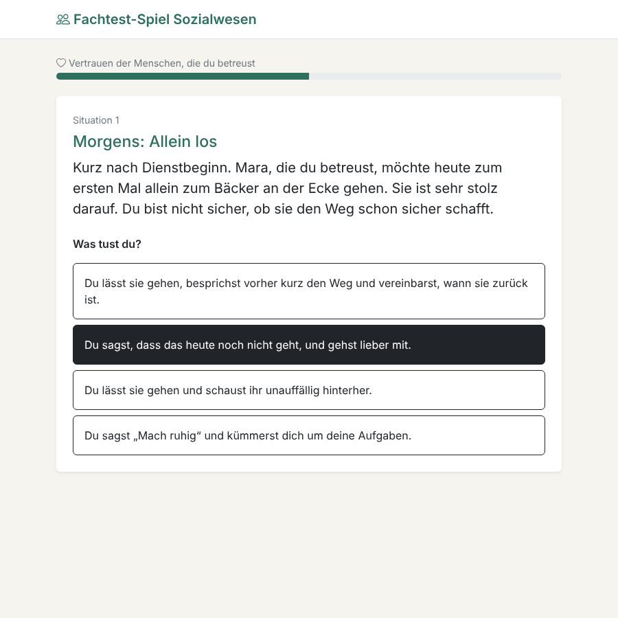
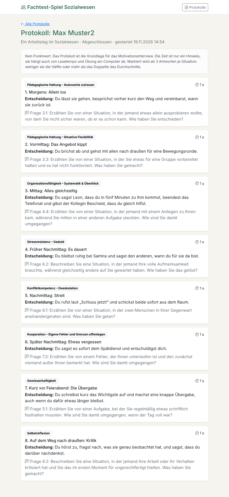

# berufetest-sozialwesen

Prototyp für das Fachtest-Spiel „Ein Arbeitstag im Sozialwesen“. Bewerberinnen und Bewerber für Berufe im Sozialwesen (Erzieher/-in, Pädagogik, Pflege usw.) erleben einen Arbeitstag mit 8 Situationen und entscheiden jeweils, wie sie handeln.

Das Spiel vergibt **keine Punkte**. Es speichert, wie eine Situation gelöst wurde und wie lange die Entscheidung gedauert hat. Daraus entsteht ein Protokoll, das der Coach im anschließenden Motivationsinterview nutzt.



## Was der Prototyp kann

- 8 Situationen, jede genau einer Kategorie aus dem Fragenkatalog des Motivationsinterviews zugeordnet (ohne Arbeits- und Lernmotivation)
- Zeitmessung pro Situation auf dem Server, vom Anzeigen bis zur Entscheidung (Neuladen setzt die Zeit nicht zurück)
- Vertrauensleiste und Folgen in der Geschichte als Belohnung, ohne Punktestand
- Eine Verzweigung: Situation 8 (Kritik einer Kollegin) hängt davon ab, wie der Streit in Situation 5 gelöst wurde
- Der Browser schickt nur die ID der gewählten Antwort, ausgewertet wird auf dem Server
- Abbrechen und später im selben Browser weiterspielen
- Protokoll für Coaches: Kategorie, Entscheidung, Zeit und passende Frage aus dem Fragenkatalog; auffällig schnelle oder lange Entscheidungen werden markiert
- Alle Situationen und Antworten lassen sich im Django-Admin bearbeiten



## Starten

Voraussetzung: Python 3.10 oder neuer.

```bash
python -m venv .venv
# Windows: .venv\Scripts\activate
source .venv/bin/activate

pip install -r requirements.txt
python manage.py migrate
python manage.py demo_laden          # legt das Demo-Szenario an
python manage.py createsuperuser     # Zugang für Coach und Admin
python manage.py runserver
```

| Adresse | Wofür |
| --- | --- |
| http://127.0.0.1:8000/ | Spiel starten (Namen eingeben) |
| http://127.0.0.1:8000/protokoll/ | Protokolle für Coaches (Login mit dem Superuser) |
| http://127.0.0.1:8000/admin/ | Situationen, Antworten und Kategorien bearbeiten |

Demo-Szenario neu anlegen (löscht auch alle Durchläufe): `python manage.py demo_laden --neu`

Tests ausführen: `python manage.py test szenario`

## Aufbau

```
config/                  Projekt-Einstellungen
szenario/
  models.py              Category, Scenario, ScenarioStep, ScenarioChoice, ScenarioSession, ScenarioAnswer
  views.py               Spielablauf, Zeitmessung, Protokoll
  management/commands/   demo_laden (Demo-Inhalte)
  templates/szenario/    Seiten des Spiels und des Protokolls
  tests.py               Tests für Ablauf, Verzweigung, Zeitmessung und Rechte
templates/base.html      Grundlayout mit Bootstrap 5.3
```

## Abgrenzung zum großen Projekt (Skill-Fit)

Der Prototyp läuft eigenständig. Für die Übernahme in Skill-Fit sind diese Schritte geplant:

- `Category` wird durch einen Fremdschlüssel auf `MotivationCategory` / `MotivationSubcategory` ersetzt, `interview_question` durch einen Fremdschlüssel auf `MotivationQuestion`
- Teilnehmer melden sich über `accounts.User` an statt mit einem Namen
- Der Coach schaltet das Spiel frei, wie beim Englisch- und Coding-Test
- Das Protokoll wird im Motivationsinterview neben den Fragen angezeigt

Die Situationen sind ein erster Entwurf und noch nicht fachlich geprüft.
